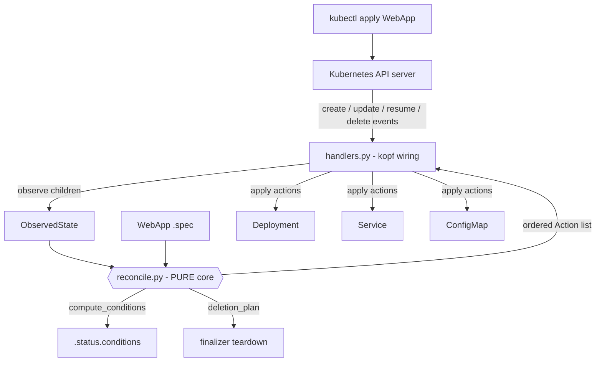

<div align="center">
  

  <h1>Kubernetes Operator</h1>

  <p><strong>A production-shaped Kubernetes operator in Python (kopf) that reconciles a <code>WebApp</code> into a Deployment, Service and ConfigMap — with a pure, fully-tested decision core.</strong></p>

  <p><em>Built and maintained by Viprasol Tech.</em></p>

  <p>
    <a href="https://github.com/Viprasol-Tech/kubernetes-operator/blob/main/LICENSE"></a>
    <a href="https://github.com/Viprasol-Tech/kubernetes-operator"></a>
    <a href="https://github.com/Viprasol-Tech/kubernetes-operator"></a>
    <a href="https://github.com/Viprasol-Tech/kubernetes-operator"></a>
    <a href="https://github.com/Viprasol-Tech/kubernetes-operator"></a>
    <a href="https://github.com/Viprasol-Tech/kubernetes-operator"></a>
    <a href="https://github.com/Viprasol-Tech/kubernetes-operator"></a>
  </p>
</div>

---

This repository implements a real Kubernetes operator for a custom resource called **`WebApp`**. A `WebApp` declares a container `image`, `replicas`, `port`, `env`, `resources`, and `config`; the operator continuously reconciles **three child resources** to match it — a **Deployment**, a **Service**, and (when `config` is set) a **ConfigMap** — and publishes `Ready`/`Progressing` status conditions.

The defining feature is its architecture: **all decision logic lives in a pure, side-effect-free, unit-tested module** (`src/k8s_operator/reconcile.py`). The kopf wiring (`handlers.py`) only translates the actions that the pure loop returns into Kubernetes API calls. This makes the hardest part of any operator — the reconcile logic — trivial to test offline, with zero cluster required.

## ✨ Features

- 🧠 **Pure reconcile loop** — `reconcile(spec, observed) -> list[Action]` is deterministic, has no I/O, and is fully covered by `pytest`.
- 🧩 **Three managed children** — a Deployment, a Service, and a ConfigMap, created and patched in a deterministic order (ConfigMap → Deployment → Service).
- 🔧 **Rich spec** — `image`, `replicas`, `port`, `servicePort`, `env`, `resources` (CPU/memory requests + limits), and `config`, each validated with precise errors.
- 📊 **Status conditions** — pure `compute_conditions()` derives Kubernetes-style `Ready`/`Progressing` conditions, published on the WebApp `.status` subresource.
- 🧹 **Finalizer-driven teardown** — a pure `deletion_plan()` returns an ordered cleanup plan (Service → Deployment → ConfigMap), skipping absent children.
- 🛡️ **CRD validation** — a real `CustomResourceDefinition` with an OpenAPI v3 schema, defaults, bounds, printer columns, and a status subresource.
- ✅ **Strict tooling** — `ruff`, `mypy --strict`, and 58 `pytest` cases, all green.

## 🚀 Quickstart

```bash
# 1. Clone
git clone https://github.com/Viprasol-Tech/kubernetes-operator.git
cd kubernetes-operator

# 2. (optional) create a virtualenv, then install dev tooling
python -m pip install -e ".[dev]"

# 3. Run the verification gate (no cluster required)
ruff check .
ruff format .
mypy src
PYTHONPATH=src python -m pytest -q
```

No Kubernetes cluster is needed to run the tests — that is the point of the pure-core design.

## 🧪 Usage (the pure core)

```python
from k8s_operator import (
    reconcile,
    compute_conditions,
    deletion_plan,
    ObservedState,
    ObservedDeployment,
    ObservedService,
)

# Nothing exists yet + config requested -> create ConfigMap, Deployment, Service.
reconcile({"image": "nginx:1.27", "replicas": 3, "config": {"a": "b"}}, None)
# [Action(CREATE_CONFIGMAP, ...), Action(CREATE, ...), Action(CREATE_SERVICE, ...)]

# Out-of-date image + replica count -> ordered patch actions.
state = ObservedState(
    deployment=ObservedDeployment(replicas=2, image="nginx:1.26", port=80),
    service=ObservedService(),
)
reconcile({"image": "nginx:1.27", "replicas": 5}, state)
# [Action(UPDATE_IMAGE, image='nginx:1.27'), Action(SCALE, target_replicas=5)]

# Everything matches and replicas are ready -> a single NOOP, Ready=True.
state = ObservedState(
    deployment=ObservedDeployment(replicas=5, image="nginx:1.27", port=80, ready_replicas=5),
    service=ObservedService(),
)
reconcile({"image": "nginx:1.27", "replicas": 5}, state)
# [Action(NOOP, reason='all child resources match spec')]

compute_conditions({"image": "nginx:1.27", "replicas": 5}, state)
# [Condition(Ready, 'True', 'AllReplicasReady'), Condition(Progressing, 'False', 'Reconciled')]

# At deletion time, the finalizer runs an ordered teardown plan.
deletion_plan(state)
# [Action(DELETE_SERVICE, ...), Action(DELETE_DEPLOYMENT, ...)]
```

## 🏗️ Architecture



The pure core (`reconcile.py`) imports **nothing** from kopf or the Kubernetes client. Everything that touches the cluster lives in `handlers.py`.

## 📚 API & feature reference

| Symbol | Kind | Purpose |
| --- | --- | --- |
| `normalize_spec(spec)` | function | Validate a raw `.spec` dict and apply defaults → `WebAppSpec`. |
| `reconcile(spec, observed)` | function | Pure decision loop → ordered `list[Action]`. |
| `compute_conditions(spec, observed)` | function | Derive `Ready` / `Progressing` `Condition`s. |
| `deletion_plan(observed)` | function | Ordered teardown plan for the finalizer. |
| `Action` / `ActionKind` | dataclass / enum | A single declarative change and its category. |
| `WebAppSpec` | dataclass | Normalized, validated spec. |
| `ResourceRequirements` | dataclass | CPU/memory requests + limits, with `to_k8s()`. |
| `ObservedState` | dataclass | Bundle of observed Deployment / Service / ConfigMap. |
| `ObservedDeployment` / `ObservedService` / `ObservedConfigMap` | dataclass | Observed child state. |
| `Condition` | dataclass | A Kubernetes-style status condition. |
| `FINALIZER` | constant | Finalizer string for ordered cleanup. |

### WebApp spec fields

| Field | Type | Default | Notes |
| --- | --- | --- | --- |
| `image` | string | — | **Required.** Container image. |
| `replicas` | integer | `1` | Must be `>= 0`. |
| `port` | integer | `80` | Container port (1–65535). |
| `servicePort` | integer | `80` | Service port (1–65535). |
| `env` | map[string]string | `{}` | Environment variables for the web container. |
| `config` | map[string]string | `{}` | Rendered into a child ConfigMap when non-empty. |
| `resources` | object | `{}` | `requests`/`limits` for `cpu` and `memory`. |

## 🖥️ Running against a real cluster

You need a working `kubeconfig` (e.g. a local [kind](https://kind.sigs.k8s.io/) or [minikube](https://minikube.sigs.k8s.io/) cluster), then:

```bash
# 1. Install the CRD
kubectl apply -f manifests/crd.yaml

# 2a. Run the operator locally (uses your kubeconfig) for development
python -m pip install -e ".[operator]"
kopf run -m k8s_operator.handlers --all-namespaces --verbose

# 2b. ...OR deploy the operator into the cluster (RBAC + Deployment)
kubectl apply -f manifests/deployment.yaml

# 3. Create a WebApp and watch the operator reconcile its children
kubectl apply -f manifests/example-webapp.yaml
kubectl get webapps
kubectl get deploy,svc,configmap -l app.kubernetes.io/managed-by=viprasol-webapp-operator

# 4. Edit the spec and watch it converge
kubectl patch webapp hello --type merge -p '{"spec":{"replicas":5,"image":"nginx:1.27"}}'
kubectl get deploy hello-web -w
```

When deploying via `manifests/deployment.yaml`, build and push a container image first and update the `image:` field to point at it (the manifest references `ghcr.io/viprasol-tech/kubernetes-operator:0.2.0` as a placeholder).

## 🗺️ Roadmap

- [x] Pure reconcile loop for the Deployment
- [x] Manage a Service and ConfigMap alongside the Deployment
- [x] `env` and `resources` spec fields with validation
- [x] Status conditions (`Ready` / `Progressing`)
- [x] Finalizer / deletion plan
- [ ] Ingress reconciliation
- [ ] HorizontalPodAutoscaler support
- [ ] Prometheus metrics endpoint for the operator
- [ ] Webhook-based admission validation

## ❓ FAQ

**Why split the logic into a "pure" module?**
The reconcile decision is the hardest part of any operator to get right. Keeping it free of I/O lets us test every branch deterministically and offline, with no mock cluster.

**Do I need a cluster to run the tests?**
No. `pytest` exercises `reconcile.py` directly; kopf and the Kubernetes client are optional runtime dependencies.

**What happens when I delete a WebApp?**
The finalizer runs `deletion_plan()`, tearing down the Service, Deployment, and ConfigMap in order. Owner references also cascade-delete children as a safety net.

## 🤝 Contributing

Contributions are welcome. Please:

1. Fork the repo and create a feature branch.
2. Keep all decision logic in `reconcile.py` (pure, no I/O) and add `pytest` cases for it.
3. Ensure `ruff check .`, `mypy src`, and `pytest` all pass before opening a PR.

## Disclaimer

This software is provided for educational and operational reference purposes. Review the RBAC, security context, and reconcile behaviour before running it against any production cluster. You are responsible for what you deploy.

## Contact — Viprasol Tech Private Limited

- Website: [viprasol.com](https://viprasol.com)
- Email: [support@viprasol.com](mailto:support@viprasol.com)
- Telegram: [t.me/viprasol_help](https://t.me/viprasol_help) | WhatsApp: +91 96336 52112
- GitHub: [@Viprasol-Tech](https://github.com/Viprasol-Tech) | [LinkedIn](https://www.linkedin.com/in/viprasol/) | X [@viprasol](https://twitter.com/viprasol)

## License

[MIT](LICENSE) (c) 2025 Viprasol Tech Private Limited
